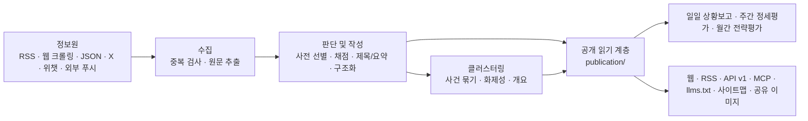

# 아키텍처



## 3대 독립 프로세스

| 프로세스 | 위치 | 역할 |
|---|---|---|
| **api** | `apps/api/` | Fastify 기반. 웹 내부 API(`/api/site/`), 공개 API(`/api/v1/`), RSS 피드, MCP 서버, 관리자 API, 이미지 프록시, 소셜 공유 이미지 생성 |
| **worker** | `apps/worker/` | pg-boss 작업 큐 및 스케줄러: 정보원 수집, LLM 호출, 사건 클러스터링, 화제성 연산, 리포트 발간, 장애 알림, 데이터 정리 |
| **web** | `apps/web/` | React Router 기반 서버 사이드 렌더링(SSR) 웹사이트. 데이터베이스에 직접 접근하지 않고 HTTP를 통해 api 프로세스만 호출 |

비즈니스 코드는 `packages/backend/`에 위치하며, 프론트엔드와 백엔드가 공유하는 타입과 상수는 `packages/contracts/`에 있습니다. 사이트 고유의 명칭, 문구, 브랜드, 페이지는 `site/`에, 도메인 분류, 정보원, 프롬프트, 커트라인은 `industry/`에 위치합니다. 이 사이트만의 독자적인 기능은 `modules/`에 모듈로 추가합니다(아래 "모듈" 항목 참조).

## 핵심 불변 원칙

- **단일 공개 읽기 계층(Single Publication Read Layer)**: 웹페이지, RSS, 공개 API, MCP, 사이트맵, 공유 이미지 등 모든 대외 채널은 `packages/backend/src/publication/`을 통해서만 데이터를 조회합니다. 공개 범위, 큐레이션 선정 조건(기계적 출력 시 동일 뉴스는 1개 기사만 노출), 팩트 근거 조건은 오직 `publication/scope.ts`에서만 정의됩니다. 새로운 대외 채널이 추가되더라도 기존의 철회(Withdrawal) 정책과 전문(Full-text) 공개 허용 규칙을 동일하게 준수합니다. 이미 발간된 보고서라도 인용문의 공개 가능 여부나 출처명은 현재 시점의 기사 상태를 따르며, 철회 시 의존하는 리드문과 커버도 함께 제거됩니다.
- **캐시는 이전 콘텐츠의 수명을 임의로 연장하지 않음**: 변경 가능한 콘텐츠는 응답의 `Cache-Control` 헤더 만료 시 반드시 재검증되어야 합니다. 사이트맵의 프로세스/디스크/HTTP 캐시는 동일한 만료 시각을 공유하며 응답 전송 시 타이머가 리셋되지 않습니다. MCP의 HTTP 응답은 항상 `no-store`를 사용합니다. 자체 리버스 프록시나 CDN을 구성할 때도 동일한 규칙을 따라야 합니다([배포 가이드](deploy.md#도메인-및-https-설정) 참조).
- **웹페이지 서빙 시 LLM을 직접 호출하지 않음**: 방문자가 페이지를 열 때는 데이터베이스에 이미 저장된 결과만 읽습니다. 모델 추론은 오직 worker의 백그라운드 큐 작업에서만 일어납니다.
- **유료 요청에 대한 영수증(Receipt) 기록**: 모든 유료 API 호출(LLM, X, 위챗, Jina 등)은 요청 전 영수증 트랜잭션을 먼저 기록하고, 결과를 수신한 뒤 저장하여 사용합니다. 프로세스 재시작이나 큐 재시도 시 이미 결제된 결과를 재사용하여 불필요한 중복 과금을 원천 차단합니다(`providers/receipts.ts`). 결과가 모호한 영수증은 30분이 지나면 자동으로 1회 해제·재처리되며, 이로 인해 실패 상태로 남은 기사는 다시 큐에 적재되어 본문 추출이나 분석을 이어갑니다. 재차 결과가 불명확할 때는 관리자가 "운영" 페이지에서 대조 후 수동 승인합니다.
- **예산 서킷 브레이커(Budget Circuit Breaker)**: 각 유료 서비스별로 분/시간/일 단위 비용 상한선이 설정되어 있으며, 초과 시 즉시 작업이 일시 정지됩니다(관리자 "설정 → 유료 요청 한도").
- **안전 밸브(Safety Valves)**: `COLLECT_ENABLED`, `MODEL_CALLS_ENABLED`, `FEISHU_CONTENT_PUSH_ENABLED`, `FEISHU_INTERNAL_ENABLED`, `INDEXNOW_SUBMIT_ENABLED` 환경변수는 로직 경로를 바꾸지 않고 오직 "실제 외부 전송 여부"만 제어합니다. 소문자 `true`로 명시해야만 동작하며 기본값은 모두 꺼짐(false)입니다. `scripts/init-env.ts`는 수집과 모델 호출을 활성화하지만, UI만 튜닝할 때는 `false`로 끌 수 있습니다. 테스트 환경에서는 외부 푸시가 항상 비활성화되고 모델 호출은 로컬 모의(Mock) 서비스만 사용합니다.
- **공개 콘텐츠의 익명성**: 관리자와 일반 방문자는 동일한 공개 콘텐츠를 봅니다. 독자의 북마크 및 읽음 상태는 브라우저 로컬 스토리지에만 저장됩니다. 관리자 페이지는 관리자 인증을 거쳐야만 접근할 수 있습니다.
- **과거 기사 도배 방지**: 수집 시점에 이미 발행된 지 48시간을 초과한 자료, 신규 소스 등록 시 최초 수집된 과거 아카이브 기사, 백필 푸시는 원문 발행일에 맞춰 아카이브되며 오늘 피드에 진입하거나 푸시 알림을 발송하지 않습니다. 신뢰할 수 있는 발행일이 확인되지 않은 자료는 우선 공개되지 않으며, 정확한 날짜가 파싱된 후 최신성 여부를 판단합니다.
- **출처 추적 가능성**: 모든 큐레이션 항목은 원문 링크를 반드시 포함합니다. 사이트 내 전문(Full-text) 노출 여부는 해당 정보원의 `site_fulltext` 설정에 의해 제어되며, 기본값은 요약만 노출됩니다.
- **도메인 모듈에 의한 상태 관리**: 관리자 인터페이스는 콘텐츠, 사건, 알림 및 복구 모듈을 호출할 뿐 해당 모듈의 DB 상태를 직접 임의 변경하지 않습니다. 업무 모듈 역시 관리자 모듈을 역참조하지 않습니다. 수동 수정, 공개 결과, 복구 이력은 원자적으로 함께 커밋됩니다.
- **프로세스 간 인터페이스 타입 공유**: 관리자 API는 `packages/contracts/src/admin.ts`를, 큐 페이로드는 `jobs/queue.ts`의 `JobData` 타입을 공통 기준으로 삼아 송수신 양측에서 정적 검사를 수행합니다.

이 모듈 경계는 `tests/architecture.test.ts`로 검증됩니다. 경계를 조정할 때는 규칙과 검사를 함께 갱신해야 합니다. 사이트 식별자와 단계별 모델은 `site/`에서, 산업 분류와 프롬프트는 `industry/`에서 읽어 들이며 코드 내에 특정 사이트 값을 하드코딩하지 않습니다.

## 디렉터리 구조

| 경로 | 내용 |
|---|---|
| `site/` | 이 사이트 고유의 설정: 사이트명, 각 단계별 모델 지정, 브랜드 및 로고, 약관 페이지, 루트 정적 파일(`public/`), 변경 이력, 활성화할 모듈 목록(`site/modules/`) |
| `industry/` | 도메인 패키지: 카테고리/태그 체계, 주요 주제(Topics), 기본 데모 정보원, 프롬프트 템플릿, 선별 커트라인 |
| `modules/` | 프레임워크 코어를 건드리지 않고 확장하는 독립 기능 모듈 (`modules/<이름>/`); 프레임워크 자체에는 모듈이 포함되지 않음 |
| `packages/backend/src/sources/` | 6종 정보원 수집기 및 크롤링 스케줄러 (`collect.ts`) |
| `packages/backend/src/content/` | 데이터 수집/적재, 중복 검사, 본문 추출 및 정제 |
| `packages/backend/src/editorial/` | 판단 및 작성 파이프라인: `analyze.ts`(워크플로우), `prompts.ts`(프롬프트 파서), `models.ts`(단계별 모델 라우팅) |
| `packages/backend/src/events/` | 사건 클러스터링, 화제성 알고리즘, 사건 종합 개요 생성 |
| `packages/backend/src/publication/` | 단일 대외 공개 읽기 계층 |
| `packages/backend/src/reports/` | 일일, 주간, 월간 리포트 편성 및 발간 |
| `packages/backend/src/providers/` | LLM, 벡터, X, 위챗, Jina 연동, 영수증 감사 및 예산 관리 |
| `packages/backend/src/notify/` | 메신저(Feishu/Lark 등) 웹훅 알림 |
| `packages/backend/src/operations/` | 알림, DB 백업, 아카이브 정리, IndexNow 검색엔진 제출 |
| `packages/backend/src/admin/` | 관리자 대시보드 API 엔드포인트 |
| `apps/web/app/routes/` | 웹페이지 라우트 컴포넌트 (라우트 맵: `apps/web/app/routes.ts`) |
| `database/migrations/` | 데이터베이스 마이그레이션 SQL 파일 (전체 파일명 순으로 실행 및 기록) |
| `scripts/` | 초기화, 마이그레이션, 시드 데이터, 평가 및 스모크 테스트 스크립트 |
| `tests/` | 백엔드 통합 및 단위 테스트 (테스트 DB명은 반드시 `_test` 또는 `_ci`로 종료) |

## 모듈 (Modules)

프레임워크 본체에 없지만 특정 사이트에만 필요한 전용 기능(예: 자체 랭킹 보드, 특정 서비스 모니터링 페이지 등)은 `modules/<모듈명>/` 디렉터리에 독립적인 npm 패키지(`@aihot/<모듈명>`) 형태로 개발합니다.

| 파일 | 역할 |
|---|---|
| `module.ts` | 모듈의 라우트 주소, 리다이렉션, API 경로 정의 (`packages/contracts/src/modules.ts`) |
| `server.ts` | 백엔드 확장 플러그인: API 라우트, 스케줄 작업, 큐 작업, 이벤트 리스너, 관리자 페이지 데이터 등 (`packages/backend/src/modules.ts`) |
| `web.tsx` | 프론트엔드 확장 플러그인: 전용 페이지, 네비게이션 메뉴, 주제/관리자 위젯 등 (`apps/web/app/modules.ts`) |
| `migrations/` | 모듈 전용 DB 테이블 마이그레이션 (`database/migrations/`와 파일명 순으로 함께 실행) |
| `tests/` | 모듈 전용 테스트 코드 (`npm test`에 포함) |
| 기타 파일 | 이미지 등 모듈 전용 정적 파일은 모듈 폴더 내에 두고 `server.ts`의 `http` 훅에서 `apps/api/src/routes/static.ts`의 `sendFile`로 서빙하며, 경로를 `module.ts`의 `apiPaths`에 등록 |

모듈 작성이 완료되면 `site/modules/`의 설정 목록(`index.ts`, `server.ts`, `web.ts`)에 등록하고 `site/package.json`의 `dependencies`에 추가합니다(Docker 배포 시 `Dockerfile`에도 `COPY modules/<이름>/package.json modules/<이름>/` 추가). 프레임워크 코어는 이 세 파일의 목록만 동적으로 읽어들이므로, 향후 업스트림 저장소의 변경사항을 머지하더라도 자체 기능과 충돌하지 않습니다.

모듈은 `agent.abilities`를 통해 MCP 도구를 제공할 수 있습니다. `scripts/mcp-check.ts`는 항상 전체 도구 집합을 검사하며, 빈 데이터베이스에서 성공하는 검사 인자를 `mcp.checkArgs`로 지정할 수 있습니다. 미지정 시 `{}`를 받는 도구만 호출 검증하고 나머지는 탐색만 수행합니다.

## 데이터베이스 마이그레이션

이미 배포된 마이그레이션 파일은 배포 히스토리이므로 절대 수정하거나 삭제해서는 안 됩니다. 수정사항은 반드시 새로운 마이그레이션 파일로 추가해야 합니다.
- 엔진과 모듈의 마이그레이션 모두 전체 파일명 기준으로 정렬되어 순차 실행·기록되며, 번호가 같더라도 파일명이 다르면 각각 실행됩니다(동일한 전체 파일명은 양쪽 디렉터리에 중복 불가).
- 마이그레이션 번호 `0055` 이후부터는 각 파일당 **온라인 무중단 실행이 가능한 단 1개의 SQL 문**만 허용됩니다. PR에서는 이를 자동 검사하며, 작은 번호로 회피할 수 없습니다. 하나의 트랜잭션 내에서 여러 테이블을 동시에 잠그거나 대규모 풀스캔 대기 현상을 방지하기 위함입니다.
- 컬럼 추가 시 `NULL 허용` 또는 상수 기본값을 우선 사용하며, 기존 테이블에 `CHECK`나 외래키 제약조건을 걸 때는 `NOT VALID`로 먼저 선언한 후 별도 마이그레이션에서 유효성을 검증합니다.
- 인덱스는 반드시 `CREATE INDEX CONCURRENTLY IF NOT EXISTS`를 사용하며, 대량의 데이터 백필(`UPDATE`/`DELETE`)은 배포 마이그레이션 파일에 넣지 않고 백업 검증 후 별도의 분할 배치 스크립트로 수행합니다.
- 다중 필터 조건의 상관관계로 인해 행 수 추정이 크게 어긋나는 경우 MCV 결합 통계를 생성한 뒤 별도 마이그레이션에서 해당 테이블의 지정 컬럼에 `ANALYZE`를 수행할 수 있습니다.
- 타입 변경·컬럼 삭제 등 파괴적 변경은 업그레이드·롤백 절차를 별도 설계해 [배포 가이드](deploy.md#서비스-업데이트-절차)에 명시해야 하며, 미사용 테이블 삭제는 `DROP TABLE IF EXISTS <테이블>`(`CASCADE` 금지) 단독 파일로 작성합니다.

## 대외 노출 엔드포인트

사건 간 `related` 연결은 생성 시 최소 2편 이상의 보도 근거가 필요하며, 브릿지 보도가 철회되거나 자격을 잃어 유효 근거가 2편 미만이 되면 공개 노출에서 제외됩니다(근거가 복구되면 다시 노출). 모든 대외 채널이 동일한 읽기 규칙을 공유합니다.

| 경로 | 내용 |
|---|---|
| `/`, `/all`, `/hot`, `/topics`, `/daily`, `/weekly`, `/monthly` | 주요 정세, 전체 동향, 실시간 핫이슈, 전략 테마, 일일 상황보고·주간 정세평가·월간 전략평가 웹 화면 |
| `/feed.xml`, `/feed/full.xml`, `/feed/all.xml`, `/feed/daily.xml`, `/feed/weekly.xml`, `/feed/monthly.xml` | RSS 피드: 추천, 추천 전문, 전체, 상황보고, 정세평가, 전략평가 (카테고리별 피드 `/feed/category/<key>.xml` 및 전문 피드 `/feed/full/category/<key>.xml` 포함) |
| `/api/v1/` | 공개 REST API (OpenAPI 사양: `/openapi-v1.json`, 에이전트 Markdown 시작점: `/api/v1/agent`, 에이전트 가이드: `/agent`) |
| `/api/mcp` | MCP(Model Context Protocol) 엔드포인트: 최신글, 검색, 핫이슈, 사건, 일일/주간/월간 리포트 조회 툴 제공 (접두사: `site/site.ts`의 `mcpPrefix`) |
| `/llms.txt`, `/sitemap.xml`, `/robots.txt` | LLM 및 검색엔진용 메타데이터 파일 (`robots.txt` 등 루트 정적 파일은 `site/public/`) |
| `/admin` | 관리자 대시보드 |

## 테스트 실행

```bash
npm run typecheck
DATABASE_URL=postgres://127.0.0.1:5432/myhot_test npm test
npm run build -w @aihot/web && npm run test:web
```

`DATABASE_URL`이 가리키는 데이터베이스 이름은 반드시 `_test` 또는 `_ci`로 끝나야 합니다. 존재하지 않을 경우 자동으로 생성되고 마이그레이션이 적용됩니다. 각 테스트 파일은 독립된 DB 복제본에서 병렬 실행되므로 DB 계정에 `CREATEDB` 권한이 필요합니다. 테스트는 외부 네트워크를 전혀 호출하지 않으며 로컬 모의(Mock) 서비스가 응답합니다.
